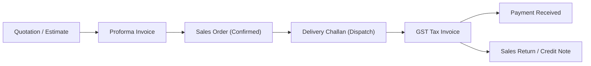

# 05 — Sales Module, POS Billing & Payment Reminders (Sales aur Billing)

Is document me hum complete **Sales Lifecycle** (Quotation → Proforma → Sales Order → Delivery Challan → Tax Invoice → POS Counter Billing → Payment Receipt → Credit Notes) aur **WhatsApp Payment Reminder** ke har ek field aur business use case ko detail me samjhenge.

---

## 1. Sales Lifecycle Overview (Sales Flow)

---

## 2. Document Stages & Fields Breakdown

### 2.1 Quotation / Estimate (`QuotationDetailView.tsx`)
Formal price proposal for prospective clients:
- **Quotation No**: E.g. `QT-2026-0012`
- **Customer Name & Billing/Shipping Address**
- **Quotation Date & Validity Cutoff Date**: Kitne dinon tak yeh rate valid hai (e.g. 15 days).
- **Line Items Grid**: Item, HSN, Qty, Rate, Discount %, GST Slab, Total.
- **Conversion**: 1-click me **Convert to Sales Order** ya **Convert to Invoice** button available hota hai.

### 2.2 Proforma Invoice (`ProformaDetailView.tsx`)
Advance payment request bill (non-GST tax commercial draft):
- Used when goods are manufactured or dispatched only after advance wire transfer.
- Has bank details and UPI QR code printed for fast wire transfer.

### 2.3 Sales Order (`OrderDetailView.tsx`)
Confirmed purchase order received from client:
- **Order Confirmation Date**
- **Delivery Target Date**
- **Fulfillment Status**: `Pending` → `Partially Fulfilled` → `Dispatched` → `Completed`.

### 2.4 Delivery Challan (`ChallanDetailView.tsx`)
Goods transport movement without tax invoice (e.g. Job work, exhibition, demo, transit):
- **Challan No & Dispatch Godown**
- **Transporter Name & Vehicle Number** (Part B compliance).

---

## 3. GST Tax Invoice (`InvoiceDetailView.tsx`)

Yeh business ka sabse critical document hai. Yahan accounting, GST tax liability, aur stock deduction ek saath execute hote hain.

### 3.1 Invoice Header & Party Fields:
- **Invoice Number**: Prefixed serial number (e.g. `INV-26-0042`).
- **Invoice Date & Due Date**: Credit period (e.g. Net 15, Net 30).
- **Customer (Party)**: Customer select karte hi GSTIN, State code, aur Place of Supply automatically fill ho jate hain.
- **Place of Supply (POS)**: Agar state same hai (e.g. Maharashtra to Maharashtra), toh **CGST + SGST** split hota hai. Agar doosra state hai, toh direct **IGST** lagta hai.

### 3.2 Invoice Item Line Grid:
- **Item Selection & Barcode Scan**: Barcode scanner se SKU scan karte hi row add ho jati hai.
- **Batch & Expiry**: Batch-tracked items ke liye dropdown se batch select hota hai.
- **Qty & Unit**: Billed quantity.
- **Rate & Discount (%)**: Negotiated unit rate aur trade discount.
- **Taxable Amount**: $\text{Qty} \times \text{Rate} - \text{Discount}$.
- **GST Rate & Tax Amount**: 5%, 12%, 18%, 28% tax breakdown.
- **Final Row Total**: Line item total inclusive of tax.

### 3.3 Invoice Totals & Summary:
- **Total Taxable Value**
- **CGST / SGST / IGST Breakdown**
- **Round Off (+/- ₹)**: Currency decimal adjustment.
- **Grand Total (₹)**: Amount payable by customer.

---

## 4. POS (Point of Sale) Counter Billing

Retail stores aur trade wholesale counters ke liye ultra-fast billing mode:
- **Barcode Scanner Integration**: USB/Bluetooth barcode reader se instant SKU lookup.
- **UPI QR Code Generation**: Screen par customer ke exact payable amount ka Dynamic UPI QR code display hota hai.
- **Thermal Receipt Printing**: 80mm / 58mm thermal receipt printers par 1-click clean bill print hota hai without margins.
- **Split Tender**: Customer partial payment cash me aur remaining UPI ya Card se pay kar sakta hai.

---

## 5. WhatsApp Payment Reminder Modal (`InvoiceDetailView.tsx`)

Payment follow-up ke liye software me direct WhatsApp share integrated hai.

### 5.1 Modal Fields (Field-by-Field Breakdown)

| Field Name | Type | Description |
|---|---|---|
| **Invoice Summary Banner** | Header Card | Invoice number (e.g. `INV-26-0042`), Due Date, aur Balance Due (e.g. `₹6,222.00`). |
| **Notice Schedule & Urgency Chips** | Filter Tabs | `Upcoming (-3d)`, `Due Today (0d)`, `Follow-up (+3d)`, `Urgent (+10d)`, `Final Notice (+30d)`. Chip click karte hi message template update ho jata hai. |
| **Message Preview (Editable)** | Textarea | Pre-filled courteous professional message containing invoice number, balance due, payment link/UPI ID, aur company name. User ise edit bhi kar sakta hai. |
| **Copy Text** | Action Button | Text clipboard me copy karne ke liye. |
| **Contact Metadata Card** | Info Card | Customer phone number (`+91 98211 55667`) aur accounts email ID. |
| **Cancel Button** | Button | Modal dismiss karta hai. |
| **Send via Email** | Button | Formal email notification dispatch karta hai. |
| **Send via WhatsApp** | **Primary Button** | **Main CTA (Green/Blue Button)** jo direct WhatsApp Web / WhatsApp Desktop par pre-filled message aur PDF link ke saath chat open karta hai. |

---

## 6. Credit Notes & Sales Returns (`SalesReturnDetailView.tsx`)

Jab customer maal wapas karta hai ya rate difference ka credit claim karta hai:
- Original Invoice reference link.
- Returned goods stock godown me re-inward ho jata hai.
- GST Output Tax liability reverse ho jati hai (GSTR-1 Table 9 adjustment).
- Customer ledger me credit balance post ho jata hai.

