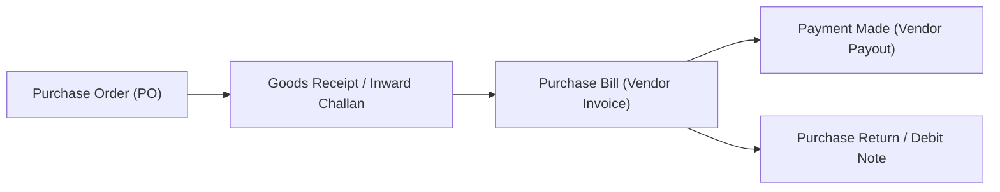

# 06 — Purchases Module, Vendor Bills & Debit Notes (Kharidari aur Suppliers)

Is document me hum **Purchase Orders (PO)**, **Goods Inward Challans**, **Purchase Bills (Vendor Invoices)**, **Payment Out**, aur **Debit Notes (Purchase Returns)** ke har ek field aur business use case ko detail me samjhenge.

---

## 1. Purchase Lifecycle Overview (Purchase Flow)

---

## 2. Purchase Order — PO (`PurchasesModule.tsx`)

PO ek formal contract document hai jo business apne suppliers/vendors ko raw material ya trading stock supply karne ke liye issue karta hai.

### 2.1 PO Form Fields (Field-by-Field Breakdown)

| Field Name | Type | Mandatory? | Field Significance & Purpose |
|---|---|---|---|
| **Purchase Order No** | Text | **Yes** | Serial number (e.g. `PO-2026-008`). |
| **Vendor / Supplier Name** | Dropdown | **Yes** | Party Master se supplier select hota hai. Supplier ka GSTIN aur payment terms auto-fill hoti hain. |
| **PO Date & Expected Delivery Date** | Date | **Yes** | Order date aur vendor se maal aane ki promised deadline. Dashboard par `Quantity to be Received` isi date se schedule track karta hai. |
| **Delivery Godown** | Dropdown | **Yes** | Kis warehouse par delivery truck unload hoga. |
| **Items Grid** | Dynamic Rows | **Yes** | Item code, ordered quantity, agreed purchase rate, GST slab, and total. |
| **Payment Terms** | Dropdown / Text | Optional | E.g. `50% Advance, 50% Against Delivery`, `Net 30 Days`. |

---

## 3. Goods Inward & Purchase Bill (`BillDetailView.tsx`)

Jab supplier ka maal factory ya warehouse gate par deliver hota hai aur vendor apna commercial invoice deta hai.

### 3.1 Purchase Bill Fields:
- **Purchase Bill No / Voucher No**: Internal accounting entry number (e.g. `PB-26-0019`).
- **Vendor Original Invoice No & Date**: Vendor ke bill par printed exact invoice number (GST input tax credit matching ke liye mandatory).
- **Vendor GSTIN & State**: Interstate vs Intrastate tax determination.
- **Input Tax Credit (ITC) Eligibility**:
  - `Eligible for ITC`: Standard business purchases jinka tax GSTR-2B me set-off milta hai.
  - `Ineligible / Blocked Credit (Section 17(5))`: E.g. Food, staff welfare, personal vehicles jinka GST credit claim nahi kiya ja sakta.
- **Reverse Charge Mechanism (RCM) Checkbox**: Agar unregistered vendor ya GTA transport service se purchase kiya hai jahan buyer ko directly GST pay karna padta hai.
- **Line Items & Stock Entry**: Qty enter karte hi warehouse stock increase ho jata hai aur item ka average purchase price update ho jata hai.

---

## 4. Payment Made — Vendor Payouts (`PaymentDetailView.tsx`)

Supplier ka outstanding balance clear karne ke liye voucher pass hota hai:
- **Payment Voucher No**: E.g. `PAY-OUT-2026-0031`.
- **Supplier Name & Current Balance**: E.g. `Balance: ₹24,250.00`.
- **Amount Paid**: Full ya partial payment amount.
- **Payment Mode**: `Bank Transfer (NEFT/RTGS/IMPS)`, `Cheque`, `UPI`, `Cash`.
- **Bank Account Used**: Company ka kaun sa bank account debit hua (Bank balance automatically update ho jata hai).
- **Transaction / UTR Reference No**: Bank confirmation number audit ke liye.
- **Bill Allocation Grid**: Specific purchase bills select karke unke against payment knock-off ki jati hai.

---

## 5. Debit Notes & Purchase Returns (`PurchaseReturnDetailView.tsx`)

Agar vendor se aaya maal defective, damaged, ya order specification ke mutabiq na ho:
- **Debit Note No**: E.g. `DN-2026-0005`.
- **Original Bill Reference**: Kis purchase bill ke against return ban raha hai.
- **Returned Items & Quantity**: Kitna maal supplier ko wapas bheja.
- **Reason**: E.g. `Quality Rejection`, `Rate Overcharged`, `Goods Broken in Transit`.
- **Accounting & Tax Impact**:
  - Warehouse stock minus ho jata hai.
  - Vendor liability utne amount se kam ho jati hai.
  - Claimed ITC reverse ho jata hai (GSTR-3B compliance).

---

## 6. Real-World Business Use Cases

### Use Case: Partial Delivery with Rate Variance
- **Scenario**: 100 units @ ₹500 ka PO diya tha. Supplier ne 80 units deliver kiye aur bill me rate ₹520 laga diya.
- **Action**: Purchase bill entry ke waqt system PO rate se compare karke red highlight karta hai. Accountant purchase manager se verify karke vendor se revised bill mangwata hai ya ₹20 per unit ka Debit Note issue kar deta hai.

