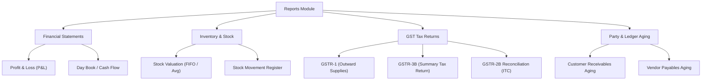

# 09 — Reports, Audits & Analytics (Business Reports aur Tax Filing)

Is document me hum **Profit & Loss Statement**, **Stock Valuation**, **GST Tax Filing Reports (GSTR-1, GSTR-3B)**, **Sales & Purchase Registers**, **Party Aging Analysis**, aur **Day Book** ke har ek report structure aur use case ko detail me samjhenge.

---

## 1. Reports Architecture (`ReportsModule.tsx`)

Business ki profitability, tax compliance, aur inventory health track karne ke liye Automate Business me categorized reporting suite hai:

---

## 2. Report by Report Breakdown (Field-by-Field)

### 2.1 Profit & Loss Statement (P&L)
Business ki net profitability calculate karta hai:
- **Revenue from Operations**: Total taxable sales revenue.
- **Cost of Goods Sold (COGS)**:
  $$\text{COGS} = \text{Opening Stock} + \text{Total Purchases} - \text{Closing Stock}$$
- **Gross Profit**: $\text{Revenue} - \text{COGS}$.
- **Operating Overheads & Expenses**: Rent, salaries, packaging, freight charges.
- **Net Profit before Tax**: Final bottom line.

### 2.2 Stock Valuation & Movement Report
Warehouse me pade maal ki exact value batata hai:
- **Opening Qty & Value**: Financial period ke start par kitna stock tha.
- **Inward Qty & Value**: Total purchases aur manufacturing additions.
- **Outward Qty & Value**: Total sales, dispatches, aur job work issues.
- **Closing Qty & Value**: Live on-hand balance.
- **Valuation Methods**: Standard FIFO (First In First Out) aur Moving Weighted Average Cost.

### 2.3 GSTR-1 Report (Outward Supplies for Government Filing)
Monthly/Quarterly GSTR-1 return file karne ke liye ready-to-upload summary:
- **Table 4**: B2B Taxable Invoices with recipient GSTIN.
- **Table 5**: B2C Large Invoices (Interstate > ₹2.5 Lakhs).
- **Table 7**: B2C Small Invoices.
- **Table 9**: Credit / Debit Notes issued.
- **Table 11**: Advance received and adjustments.
- **Table 12**: HSN-wise summary of outward supplies (HSN code, Description, UOM, Qty, Taxable Value, CGST, SGST, IGST).

### 2.4 GSTR-3B Report (Monthly Tax Settlement)
- **Table 3.1**: Tax on Outward Supplies (Total payable tax).
- **Table 4**: Eligible Input Tax Credit (ITC available from purchase bills).
- **Net Cash Tax Liability**: $\text{Output Tax} - \text{Available ITC}$.

### 2.5 Party Receivables Aging Report (Collection Analysis)
Customer dues ko time-buckets me categorize karta hai:
- `0 - 15 Days (Current)`: Naye bills.
- `16 - 30 Days`: Due for collection.
- `31 - 60 Days`: Overdue, gentle reminder needed.
- `61 - 90 Days`: High risk overdue.
- `90+ Days (Bad Debt Risk)`: Legal notice / final escalation.

### 2.6 Day Book (Daily Cash & Transaction Ledger)
Kisi specific date par hui har single commercial activity ka consolidated chronologic log:
- Har cash receipt, bank payment, invoice, purchase entry, aur expense voucher with time stamp and user audit trail.

---

## 3. Real-World Business Use Cases

### Use Case: Monthly CA Tax Filing
- **Scenario**: Har mahine ki 10 tareekh ko Chartered Accountant (CA) ko GST filing data chahiye hota hai.
- **Action**: Accountant `Reports > GST Returns` me jata hai, Financial Month select karta hai, aur **"Export GSTR-1 (Excel / JSON)"** click karta hai.
- **Result**: Data bina kisi manual calculation ya Excel formatting ke direct GST government portal offline tool ke exact JSON format me export ho jata hai.

